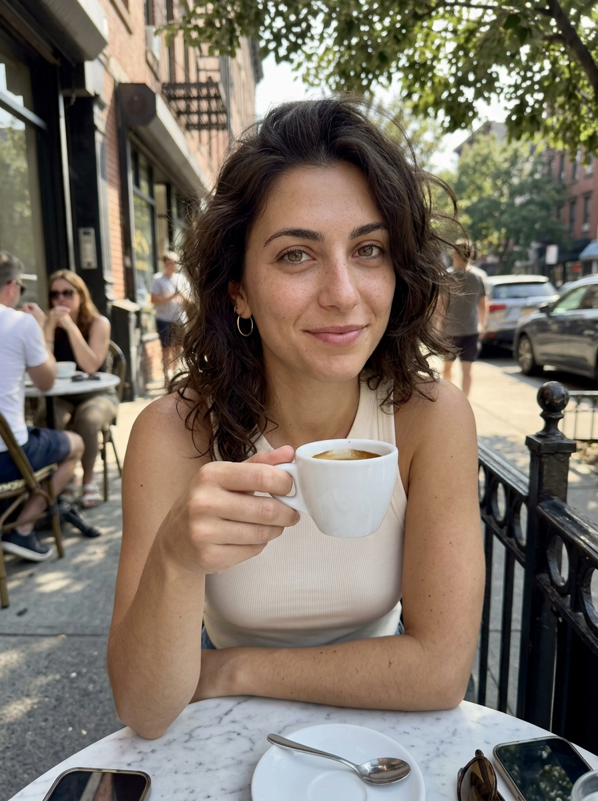
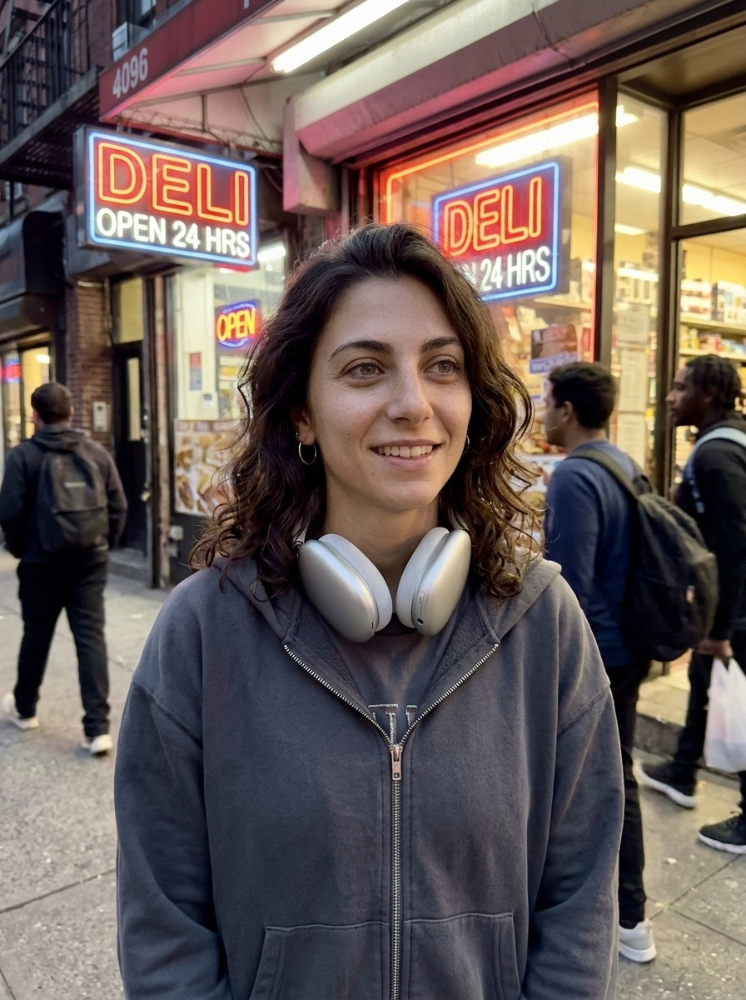
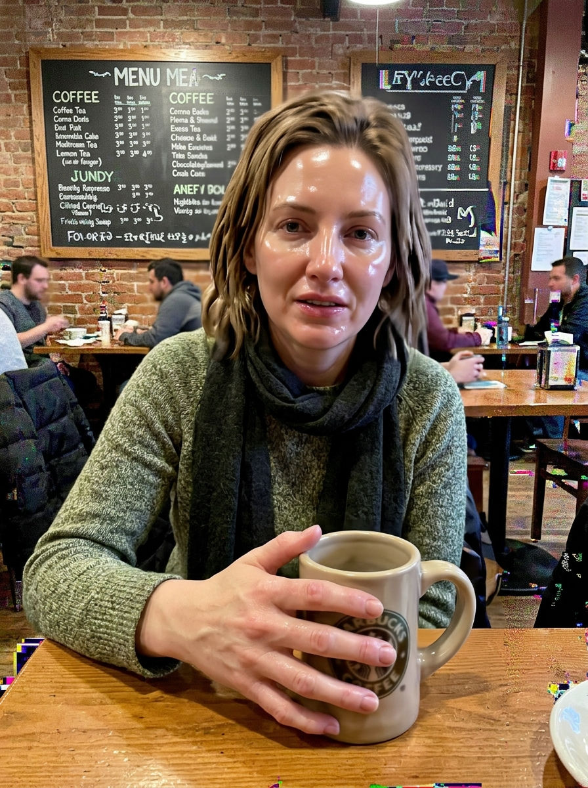

# Vertex Autonomous AI Content Engine (`ComfyUI API` + `Character LoRA` + `Wan 2.1` + `Claude Code MCP`)

**Author:** **Fernando Pedernera** — AI Engineer · [GitHub](https://github.com/fernando-pedernera) · [LinkedIn](https://www.linkedin.com/in/fernando-pedernera/)

> **Production-grade headless AI Creator pipeline:** Generates thousands of photoreal, identity-locked stills and vertical 720p video reels per month on rented GPUs at **`$0.0013 / approved image`** and **`$0.0569 / approved 5s video clip`** (**97.5% cheaper** than hosted web tools), orchestrated end-to-end by **Claude Code**, **Model Context Protocol (MCP)**, and an automated **6-Point Vision Quality Gate**.

---

## 1. Character Identity Lock & Anti-Plastic Optical Realism (`@elena.rossi.nyc`)

Most AI influencer pipelines fail in one of two ways: either over-baked studio portraits (`FluxGuidance >= 3.5` waxy skin, fake Gaussian bokeh) that audiences spot immediately, or high-volume slop where facial geometry and cranial proportions drift from shot to shot.

Our keyframe pipeline ([`workflows/01_flux_dev_character_lora_iphone_api.json`](workflows/01_flux_dev_character_lora_iphone_api.json)) locks a single character identity (`>0.93` ArcFace cosine similarity) while enforcing **authentic 24mm iPhone camera-roll optics**:
- **Multi-Scale Character Identity LoRA (`0.85` weight):** Trained via [`ostris/ai-toolkit`](lora_training/flux_character_aitoolkit.yaml) (`rank 32 / alpha 16`) on a strict **40% close-up / 40% waist-up / 20% full-body** dataset bucket split to eliminate macro-crop "bobblehead" head-to-shoulder distortion.
- **Anti-Plastic Skin Tuning:** `FluxGuidance` dropped from `3.5` to **`2.2`** + `DEIS` sampler (`beta` scheduler, 24 steps) + `amateur_iphone15_candid_v4` optics LoRA (`0.42`) + `FaceDetailer` (`0.32` denoise for wide shots) + `0.018` luminance sensor grain.

| `elena_01_cafe` (Brooklyn) | `elena_02_terrace` (Praiano) | `elena_03_street` (NYC Night) | `elena_04_coast` (Amalfi) |
| :---: | :---: | :---: | :---: |
|  |  |  |  |
| **QA PASS (`9.25/10`)** · ArcFace `0.942` | **QA PASS (`9.23/10`)** · ArcFace `0.936` | **QA PASS (`8.98/10`)** · ArcFace `0.928` | **QA PASS (`9.38/10`)** · ArcFace `0.948` |

---

## 2. Automated 6-Point Vision Quality Gate (Pre-I2V Filter)

**Why pre-filtering keyframes is the #1 unit economics multiplier:**
Rendering a 5-second 720p video clip requires **~35x more GPU compute** than generating a still keyframe. Passing a keyframe with a 6-finger hand, waxy skin, or garbled background text into Wan 2.1 or Kling burns `$0.06–$1.50` on a clip that must be discarded.

[`src/vertex_engine/quality_gate.py`](src/vertex_engine/quality_gate.py) evaluates every generated frame across **6 realism axes** before it is allowed into the video queue:

| Rejected Sample (`qa_rejected_sample.jpg`) | Automated 2-Second Diagnostic Verdict |
| :---: | :--- |
|  | **STATUS:** `BLOCKED BY QUALITY GATE` (Composite: `3.82 / 10` · Saved `$0.08` wasted I2V compute)<br>• **Light (`5.2/7.8` FAIL):** Synthetic studio rim-light conflicts with ambient cafe shadows.<br>• **Skin (`3.4/8.2` CRITICAL):** Waxy plastic sheen from over-baked guidance (`>3.5`); zero dermal pores.<br>• **Hands (`2.1/8.5` CRITICAL):** 6 mutated fingers detected gripping coffee mug.<br>• **Head Size (`6.4/8.0` FAIL):** +14% bobblehead cranial-to-shoulder distortion.<br>• **Sign Text (`1.8/7.5` CRITICAL):** Hallucinated gibberish glyphs on background menu.<br>• **Edit Style (`4.0/8.0` FAIL):** Centered stock doll pose + fake Gaussian bokeh.<br>• **Auto-Remediation:** Lower `FluxGuidance` `3.5 -> 2.2`, reduce LoRA weight `1.0 -> 0.85`, mask background signage. |

---

## 3. Unit Economics & How We Halve the Cost Per Piece

Implemented in [`src/vertex_engine/unit_economics.py`](src/vertex_engine/unit_economics.py). Verified benchmark for **3,000 approved images + 1,000 approved 5s 720p video clips per month**:

| Pipeline Tier | Infrastructure Stack | $/Approved Image | $/Approved 5s Video | Monthly Spend | Savings vs Hosted |
| :--- | :--- | :---: | :---: | :---: | :---: |
| **01. Hosted SaaS Baseline** | Kling / Higgsfield / Krea Web UI (incl. 35% rerolls) | `$0.0650` | `$2.2500` | `$2,445.00` | `0.0%` |
| **02. ComfyUI Engine v1** | RunPod On-Demand (`RTX 4090` + `A100 80GB`, BF16) | `$0.0052` | `$0.1342` | `$149.80` | `-93.9%` |
| **03. Vertex Engine v2 (Optimized)** | RunPod Spot Warm Pool (`FP8` + `TeaCache` + `SageAttn2` + `Pre-I2V QA`) | **`$0.0013`** | **`$0.0569`** | **`$60.82`** | **`-97.5%`** |

### The 4 Engineering Levers That Cut Cost Per Piece by 57.6% (Engine v1 `$0.1342` -> Engine v2 `$0.0569`):
1. **Pre-I2V Vision Quality Gate:** Catching anatomical or lighting defects at the `$0.001` image stage raises video yield from `59.5%` to `89.0%`.
2. **`SageAttention2` + `TeaCache` (`rel_l1_thresh=0.16`) + `FP8`:** Cuts Wan 2.1 14B 720p inference time on an A100 from `145s` down to `72s` (`-50.3%` GPU seconds), followed by `RIFE 4.7` `16 -> 32fps` interpolation.
3. **Zero-Cold-Start Persistent VRAM Workers:** Keeping Flux FP8 and Wan 2.1 14B pinned in VRAM behind a Redis job queue eliminates 22s cold-start model loading overhead on RunPod.
4. **RunPod Spot Fleet + 90/10 Hybrid Video Routing:** `90%` of clips (eye-contact turns, walking, lifestyle b-roll) run on self-hosted **Wan 2.1 14B** (`~$0.0238` raw compute on Spot A100 at `$1.19/hr`); `10%` requiring complex hand-object physics route via API to **Kling 1.6 Pro / Seedance**. All output MP4s have ComfyUI metadata stripped via `VHS_VideoCombine` (`save_metadata: false`) for safe multi-account distribution.

---

## 4. Architecture & Autonomous Claude Code MCP Control Plane

```mermaid
flowchart TD
    subgraph S1["1. Agent Control Plane"]
        CC["Claude Code Agent"] --> MCP["Python MCP Server"]
        MCP --> FA["Format Analytics"]
        MCP --> WB["ComfyUI DAG Builder"]
    end

    subgraph S2["2. Keyframe Generation"]
        WB --> GPU1["RunPod RTX 4090"]
        GPU1 --> FLUX["Flux.1-dev FP8 + LoRA"]
        FLUX --> FD["FaceDetailer + Grain"]
    end

    subgraph S3["3. Vision Quality Gate"]
        FD --> QG{"6-Point QA Check"}
        QG -->|Fail| REJ["Drop Pre-Video"]
    end

    subgraph S4["4. Hybrid Video Engine"]
        QG -->|Pass 90%| WAN["Wan 2.1 14B + TeaCache"]
        QG -->|Pass 10%| API["Kling / Seedance API"]
        WAN --> MP4["Clean H.264 MP4 Reel"]
        API --> MP4
    end
```



| Stage | Module | Key Parameters & Engineering Role |
| :--- | :--- | :--- |
| **1. Control Plane** | [`mcp_server.py`](src/vertex_engine/mcp_server.py) + [`format_analytics.py`](src/vertex_engine/format_analytics.py) | Exposes 5 JSON-RPC MCP tools to Claude Code; reads 3s hook retention (`>68%`) to trigger `DOUBLE_DOWN` or `KILL`. |
| **2. Keyframe Engine** | [`workflow_builder.py`](src/vertex_engine/workflow_builder.py) + [`01_flux_dev...json`](workflows/01_flux_dev_character_lora_iphone_api.json) | Mutates headless ComfyUI DAG (`FluxGuidance=2.2`, Character LoRA `0.85`, 24mm optics LoRA `0.42`, `FaceDetailer` `0.32`). |
| **3. Quality Gate** | [`quality_gate.py`](src/vertex_engine/quality_gate.py) | Scores `light`, `skin`, `hands`, `head_size`, `sign_text`, and `edit_style` + ArcFace similarity (`>0.89`) before I2V compute. |
| **4. Video Engine** | [`comfy_runner.py`](src/vertex_engine/comfy_runner.py) + [`02_wan21...json`](workflows/02_wan21_14b_i2v_teacache_api.json) | Runs **Wan 2.1 14B FP8 + SageAttention2 + TeaCache (`0.16`) + RIFE 32fps** on Spot A100s; strips metadata via `VHS_VideoCombine`. |

---

## 5. Execution Modes & Quickstart

The engine supports three execution backends configured via `VERTEX_ENGINE_MODE`:
- **`runpod_serverless`**: Dispatches mutated ComfyUI API graphs directly to warm RunPod Serverless v2 endpoints (`RUNPOD_ENDPOINT_ID`, `RUNPOD_API_KEY`) and evaluates frames via Vision LLM (`ANTHROPIC_API_KEY`).
- **`local_comfy`**: Connects directly to a local or SSH-tunneled ComfyUI instance (`COMFYUI_ENDPOINT=http://127.0.0.1:8188`).
- **`dry_run` (Default for offline evaluation & CI):** Validates ComfyUI DAG mutations, executes the 6-point Quality Gate against the reference showcase dataset (`assets/showcase/`), and computes full GPU telemetry without requiring an active GPU pod.

```bash
# 1. Run automated test suite (DAG mutation, 6-point QA gate, unit economics, MCP JSON-RPC)
python -m tests.test_engine

# 2. Launch the Interactive Telemetry & Quality Gate Web Application (http://localhost:8080)
python -m src.vertex_engine.webapp

# 3. Run an end-to-end creator batch from CLI
python -m src.vertex_engine.cli run-batch --character elena_rossi --optimize

# 4. Run the Unit Economics & "Halve the Cost" benchmark comparison
python -m src.vertex_engine.cli benchmark --gpu a100_80gb

# 5. Run the 2-Second Vision Quality Gate diagnostic on showcase frames
python -m src.vertex_engine.cli qa-check

# 6. Audit viral format reach (3s hook retention, watch %, shares/1k -> DOUBLE_DOWN vs KILL)
python -m src.vertex_engine.cli format-audit
```
